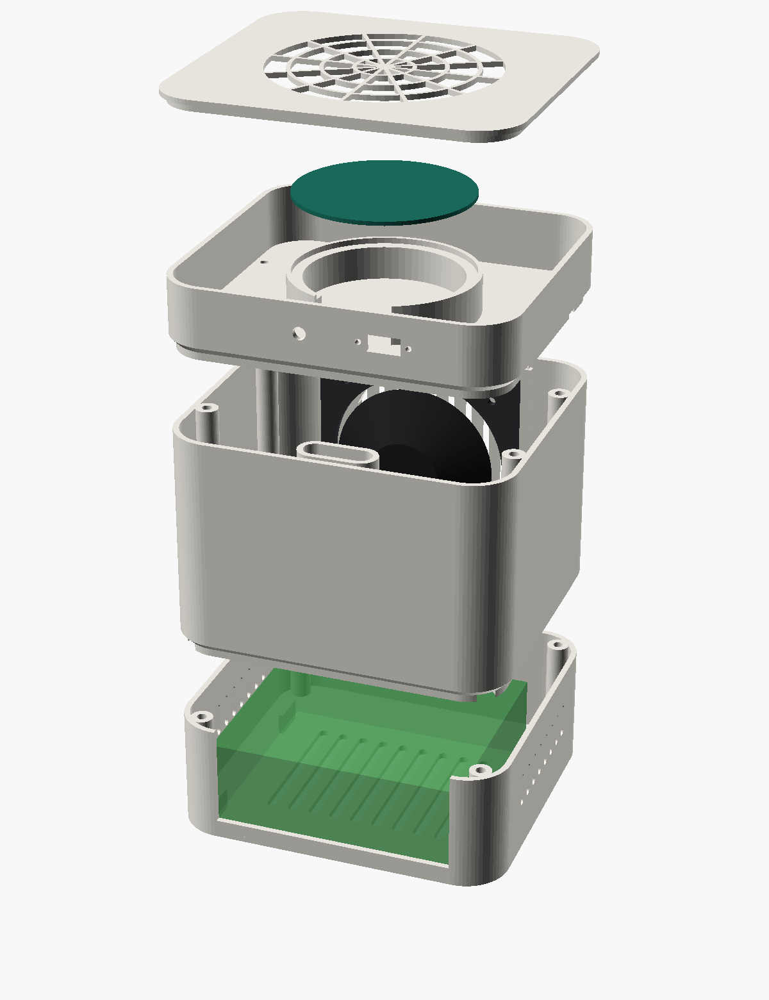
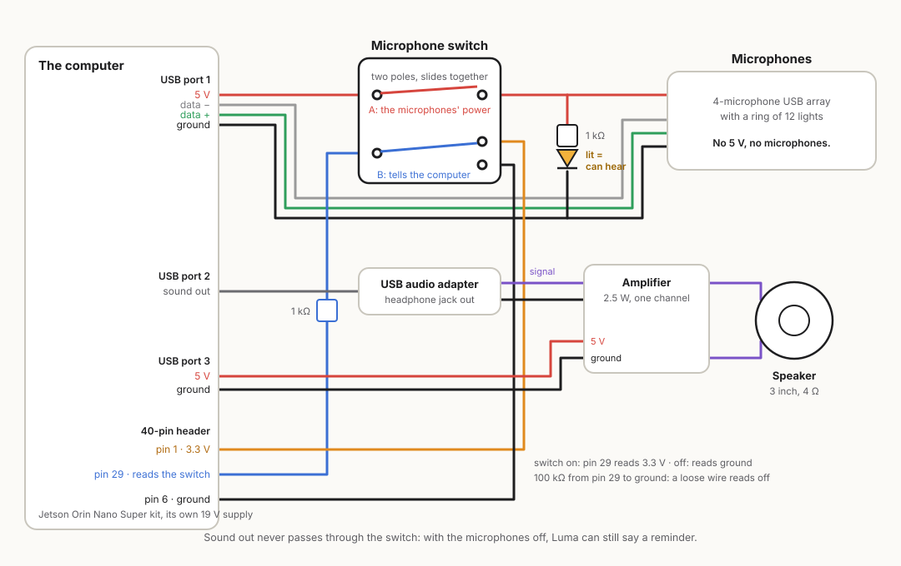
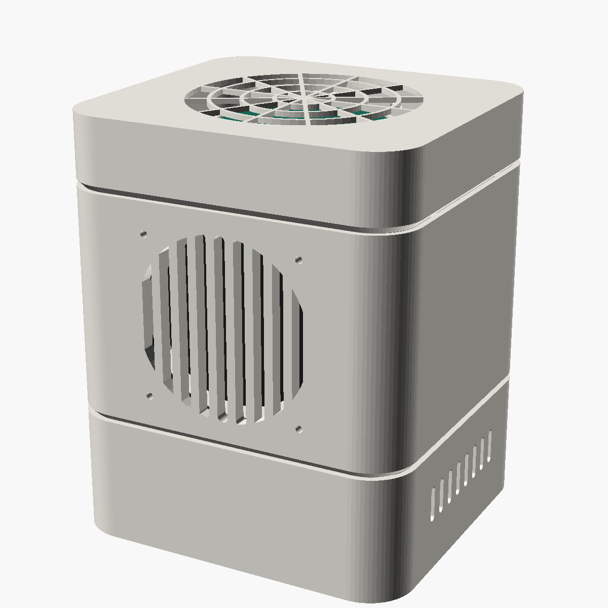
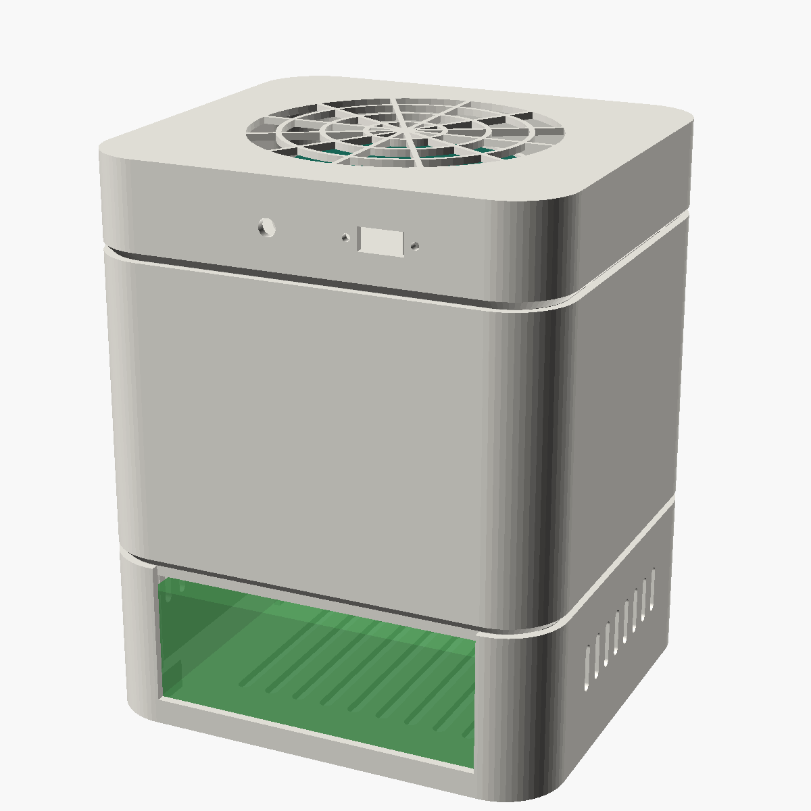
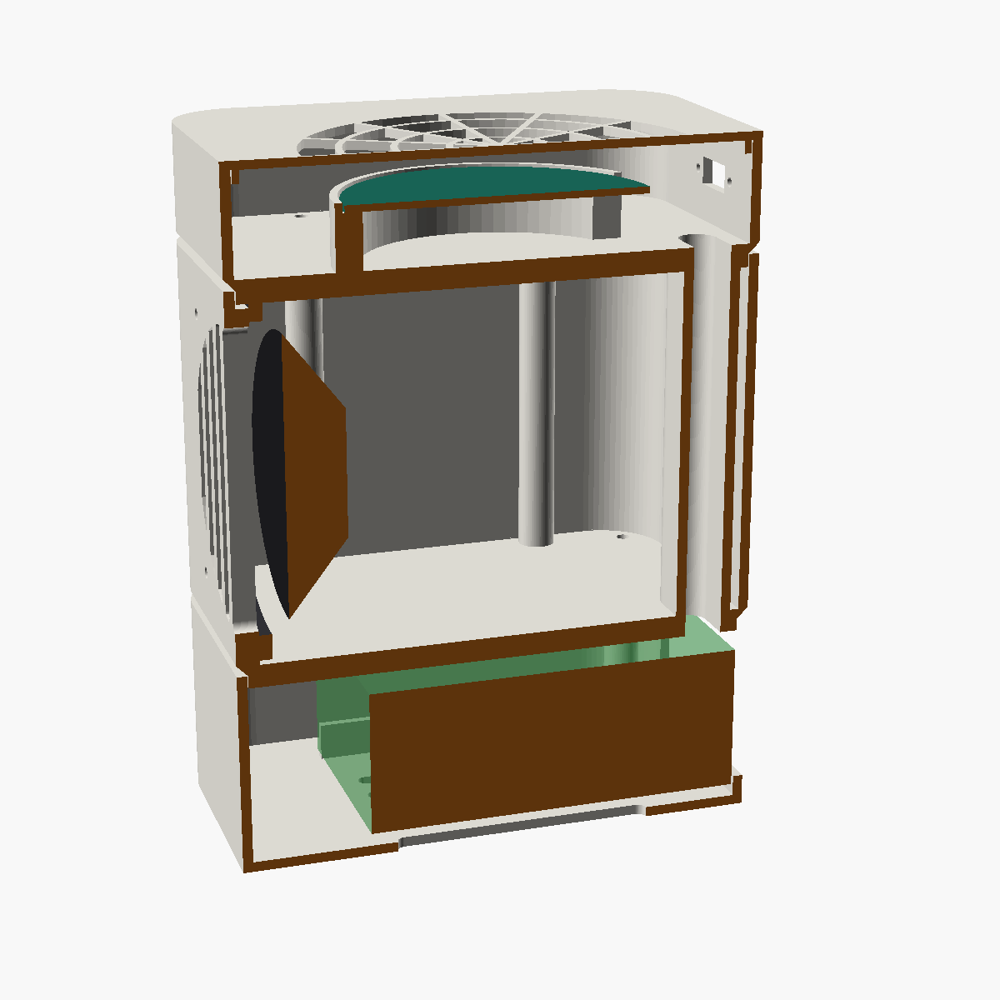

# Luma Home: the first one you can build

A speaker for the kitchen counter that Luma lives in. It hears the room, talks back, and thinks inside the box.



**What this is, plainly.** A design you can build from parts you can buy, with a case you can print. The parts are real,
the wiring is ordinary, and the case's files were built and measured by the CAD program. **Nobody has built this exact
unit yet.** The last section lists what has to be proven on a bench before anyone calls it a product.

It's 136 mm wide, 124 mm deep and 165 mm tall: about the size of a small bookshelf speaker.

## Four ideas the hardware is built around

1. **The microphone switch is real.** It doesn't ask software to stop listening. It cuts the microphones' power wire. With
   no power they are not a device the computer can see at all.
2. **The light can't lie.** A small amber light is wired to the microphones' own power, after the switch. If it's lit,
   they have power and can hear. If it's dark, they can't. No software sits between the two.
3. **Luma can still speak with the microphones off.** Sound out goes a different way, so a reminder ("time for your
   evening pills") still comes.
4. **It thinks at home.** The brain is in the box. No camera in this one: a friend to talk to doesn't need eyes, and
   one less sensor is one less thing to trust.

## Parts

Prices are for one of each, from the makers' own shops or the usual sellers. The computer's price was checked on
November 12, 2026 (list price $249; some sellers charge a good deal more, so shop around). The rest are the prices I know
of and may have moved: check before you order.

| Part | Which one | About | Why this one |
|---|---|---|---|
| The computer | NVIDIA Jetson Orin Nano Super developer kit, 8 GB (comes with its 19 V supply and a Wi-Fi card) | $249 | Meant to run Luma's 4B brain on its graphics chip, alone, with no other computer in the home |
| Storage | NVMe M.2 drive, 256 GB | $35 | The brain, the voices and years of memories |
| Microphones | Seeed ReSpeaker Mic Array v2.0 (4 microphones, a ring of 12 lights, USB) | $67 | Hears across a room, and its ring of lights is Luma's glow |
| Sound out | Any plain USB audio adapter with a headphone jack | $8 | Its own path, so the switch never silences Luma |
| Amplifier | Adafruit PAM8302, 2.5 W, one channel | $4 | Small, runs on 5 V |
| Speaker | 3 inch, 4 Ω, 3 W full-range driver | $2 to $10 | Fits the front of the case; a better driver is the cheapest upgrade there is |
| The switch | Slide switch, two poles, two positions (DPDT), panel mount, rated 0.5 A or more | $2 | One pole cuts the power, the other tells the computer |
| The light | 5 mm amber LED and a 1 kΩ resistor | $1 | Lit means they can hear |
| Small parts | 1 kΩ and 100 kΩ resistors, a short USB-A to micro-B cable to cut, a USB-A plug with bare wires, a 3.5 mm plug with bare wires, hook-up wire, heat-shrink | $10 | |
| Fixings | 8 brass M3 heat-set inserts, 8 M3 × 12 screws, 4 M3 × 8 screws for the speaker, 2 M2 screws for the switch (and nuts if its ears aren't threaded), 4 stick-on rubber feet, 1 mm foam tape | $6 | |
| Plastic | PETG, about 350 g | $8 | Stands up to the warmth of the computer better than PLA |
| | **Total** | **about $395** | |

## Wiring



Everything plugs into the computer's own USB ports, except three thin wires to its 40-pin header.

**The microphone switch (do this one carefully).**

1. Cut the short USB cable in the middle. Inside are four wires: red (5 V), white (data −), green (data +), black (ground).
2. Join white to white, green to green and black to black again, soldered, each in heat-shrink. Keep the white and green
   pair twisted right up to the joints.
3. The red wire from the computer's side goes to the middle lug of the switch's first pole. The red wire from the
   microphones' side goes to the outer lug that the middle one touches when the switch says ON.
4. The light: from that same outer lug (the microphones' side), through the 1 kΩ resistor, to the LED's long leg. The
   LED's short leg goes to black. Now the light is on exactly when the microphones have power.
5. The second pole tells the computer. Its middle lug goes, through a 1 kΩ resistor, to header pin 29. Its ON lug goes to
   pin 1 (3.3 V). Its OFF lug goes to pin 6 (ground). Add the 100 kΩ resistor from pin 29 to ground, so a wire that comes
   loose reads as OFF.

Pin 29 is the pin I propose: on NVIDIA's pinout it's a plain input. **Check it against the pinout for your board before
you wire it.** Then tell Luma:

```
LUMA_PRIVACY_GPIO=29
LUMA_PRIVACY_ACTIVE_LEVEL=0
```

**Sound out.** USB audio adapter into a USB port. Its headphone jack goes to the amplifier's input (tip to A+, sleeve to
A−). The amplifier's 5 V and ground come from the bare-wire USB plug in a third USB port. The amplifier's two output
screws go to the speaker's two tabs. Neither speaker wire is ground: don't join them to anything else.

## The case

| | |
|---|---|
|  |  |



Three sections and a lid, bottom to top:

- **Base.** The computer stands on its own feet between four guides. Air comes in through slots underneath and leaves
  through the sides. Every port is reachable through one window at the back.
- **Middle.** A sealed box for the speaker, which fires out the front through nine slots. A walled chimney at the back
  carries the cables up without opening the box.
- **Top.** The microphone ring sits on a raised ring, outside the speaker's box. The switch and its light are at the back.
- **Lid.** An open lattice over the microphones and their ring of lights.

Files: [`luma_case.scad`](luma_case.scad) is the drawing, with every size as a number you can change. The seven printable
parts are in [`stl/`](stl/).

**Print it.** PETG, 0.2 mm layers, 3 walls, 20% infill, no supports. Base, middle and top stand as drawn. The lid lies on
its face. Use a brim on the middle and the top.

1. Print `fit.stl` first. It's three thin rings: lay your computer, your speaker and your microphone board in them. If one
   is tight or loose, change that number in `luma_case.scad` and make the parts again: `python scripts/case_parts.py`
   (it needs OpenSCAD, which is free).
2. Print `base`, `mid`, `top`, `lid`, `ring` and `plate`.
3. Press the heat-set inserts in with a soldering iron: four in the base's corner posts, four in the middle's side ribs.

For a Raspberry Pi 5 instead of the Jetson (the smaller device below), set `pi5 = true`, `board_w = 85`, `board_d = 56`
and `board_h = 30`, and make the base again (`python scripts/case_parts.py base`).

## Putting it together

1. Fit the storage drive to the computer. Set the computer in the base, ports to the back window. Stick on the feet.
2. Screw the speaker to the inside of the middle section's front wall, with the clamp ring behind it. Solder its two
   wires and pass them down through the small hole in the floor. Seal that hole with a dab of hot glue.
3. Fix the amplifier and the USB audio adapter in the base, beside the computer, with double-sided tape.
4. Screw the middle onto the base (four screws, down through its floor into the corner posts).
5. Run a strip of foam tape around the middle's top rim. That's the seal for the speaker's box.
6. Mount the switch and press the LED into the back of the top section. Feed the cut USB cable and the three header wires
   down the chimney.
7. Screw the top onto the middle (four screws, down through its floor into the side ribs).
8. Lay the microphone board on its ring, plug in its USB cable, and press the lid on.
9. Screw the little plate over the switch from outside. It says MIC and OFF.

## Turning it on

Follow [`docs/DEVICE_SETUP.md`](../docs/DEVICE_SETUP.md): install on the Jetson, copy the brain and the voices, pick the
microphone array as the input and the USB audio adapter as the output, and start Luma. It starts with the microphones
muted in software too, until you say otherwise.

## Check it before you trust it

| Check | How | It passes when |
|---|---|---|
| The switch cuts power | Switch OFF. Put a meter on the microphones' red wire | 0 V |
| The computer can't see them | Switch OFF. Run `arecord -l` | The microphone array isn't in the list |
| The light tells the truth | Slide the switch back and forth | Lit only when the array is in the list |
| Luma knows | Switch OFF, open Luma's panel | It shows the microphone as off, and it won't listen |
| A loose wire is safe | Pull the wire off pin 29 | Luma treats it as OFF |
| Luma can still speak | Switch OFF, set a one-minute timer from the phone | You hear it |
| It keeps cool | Talk with it for thirty minutes with the case closed, watching `tegrastats` | The computer stays under its own limit and doesn't slow down |
| It hears over itself | Play music through it at a normal volume and speak from across the room | It hears you |

## Two sizes, and the big picture

| | Luma Home (this build) | Luma Mini |
|---|---|---|
| The computer | Jetson Orin Nano Super, 8 GB | An 8 GB ARM board such as a Raspberry Pi 5 |
| The brain inside | The 4B brain | The 1.7B brain |
| Stands alone | Yes | Yes, with a simpler brain |
| Parts, for one | about $395 | about $240 |
| Same case, same switch, same wiring | yes | yes (`pi5 = true`) |

**Thinking big.** A home can hold one mind and many voices. When a bigger computer is at home and its owner says yes (a
Mac Studio, for one), either device thinks with that computer's brain over Luma Link, and falls back to its own when it's
away. The safety net, the microphone switch and the memories stay in the device either way.

## What isn't proven yet

- Nobody has assembled this unit. The fit of the three bought parts in the case is from the makers' published sizes;
  that's what `fit.stl` is for.
- Heat with the case closed has not been measured.
- Sound has not been measured: how well four microphones hear over a speaker ten centimetres below them, how the box
  sounds, whether the fan can be heard on a recording.
- Pin 29 has not been tried on a board.
- Luma has run on a Mac and on GitHub's computers. It has not yet run on a Jetson (see `docs/DEVICE_SETUP.md`).
- The microphone array's ring of lights shows where a voice comes from by itself. Luma driving it (the water look) is
  not written.
- The parts list tops out near $395, so the $199 price on the website isn't reachable with this computer.

## From this to a product

This build is the first of the three usual steps.

1. **This one (engineering test).** Bought boards in a printed case. Proves the idea, the switch and the sound.
2. **Design test.** One board of Luma's own instead of a developer kit: the computer module, four microphones, the
   speaker amplifier, and the switch cutting the microphones' power on the board itself. A moulded case.
3. **Production test.** The same thing made in the hundreds, tested on a line.

Before it's sold or handed out, these need a compliance lab and a lawyer. This list is a starting point, not advice:

- **Radio and interference:** FCC Part 15 for the finished device. A radio module that's already certified makes this
  much simpler. A developer kit can't be resold as a product.
- **Electrical safety:** a listed power supply, and a case material with a flame rating (a printed case is for
  prototypes).
- **Connected-device rules:** no shared default passwords. Luma already pairs each phone with its own code.
- **Children:** if kids mode is offered to children under 13, the rules for children's privacy apply.
- **Health claims:** Luma is company, not treatment. Claims should stay there. `docs/CLINICAL_SAFETY.md` is the
  document for clinicians.
- **Public programs:** accessibility (a report against Section 508), and a plain account of what data exists and where
  it lives. For Luma that account is short: it's in the home.

Files here are MIT-licensed.
